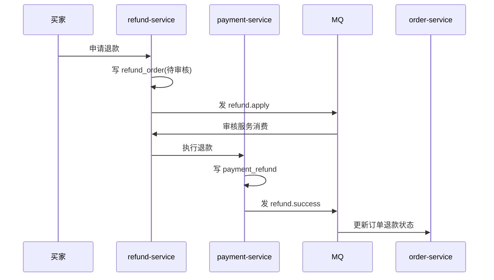

# 样例：退款链路端到端产出（格式对齐用）

> **本文件是虚构小系统的格式样例**，用于对齐 L0–L6 产出形态，证据行号均为示例格式，不得直接引用。
> 实际分析时替换为真实仓库的 `文件:行号`；证据拿不到的字段按 `references/verification-checklist.md` 标注。

## 0. 系统一句话定位

示例电商平台后端（`repo/mall`）：买家下单与支付，客服处理退款，系统以 MQ 驱动订单状态同步。基线 commit `abc1234`。

---

## L0 系统概览（节选）

**信息来源**：`repo/mall/pom.xml`、`src/main/java/**/controller/`、`src/main/resources/application.yml`

### 入口清单

| 类型 | 路径/名称 | 所属模块 | 说明 | 证据 |
|---|---|---|---|---|
| HTTP | POST /refund/apply | refund-service | 买家发起退款 | src/refund/controller/RefundController.java:41 |
| HTTP | POST /refund/audit | refund-service | 客服审核退款 | src/refund/controller/RefundController.java:58 |
| MQ | refund.apply | refund-service | 审核服务消费 | src/refund/mq/RefundApplyConsumer.java:22 |
| Job | RefundTimeoutJob | refund-service | 超时自动关闭 | src/refund/job/RefundTimeoutJob.java:15 |

（系统仅 4 类入口共 12 条，判定依据：其余 Controller 均为查询类，不改变业务状态。）

---

## L2 退款链路（节选）

**信息来源**：`src/refund/**`、`src/payment/**`、`src/order/**`

### 逐节点说明

| 节点 | 具体功能 | 内部执行逻辑 | 入参/参数传递规则 | 出参 | 状态流转条件 | 证据 |
|---|---|---|---|---|---|---|
| 申请退款 | 创建退款单 | 校验订单状态→写 refund_order | HTTP body {orderId, reason}，@Valid 校验 | refundNo | 待审核（新单创建） | src/refund/service/RefundApplyService.java:33 |
| 执行退款 | 调支付网关退回 | 重试 3 次→回调写结果 | 内部 RPC，refundNo | 支付流水号 | 退款中→退款成功/失败 | src/payment/service/PaymentRefundService.java:57 |
| 更新订单 | 同步订单状态 | 消费 refund.success → 更新 status | MQ 消息 {refundNo, status} | — | refund_success [待确认：查 MQ 控制台生产者是否为 payment-service] | src/order/mq/OrderStatusConsumer.java:44 |

### 异常分支

- 网关超时 → 重试 3 次后置退款失败，待人工介入 [证据：src/payment/service/PaymentRefundService.java:88]

### 事务边界与失败补偿

- refund_order 写入与 MQ 发送不同事务；发送失败走本地消息表重投 [证据：src/refund/mq/OutboxPublisher.java:19]

---

## L4 核心表清单（节选）

| 表名 | 中文名 | 业务对象 | 主键 | 状态字段 | 写入方 | 读取方 | 关联表 | 证据 |
|---|---|---|---|---|---|---|---|---|
| refund_order | 退款单 | 退款 | id | status | refund-service | 后台、App、报表 | refund_item、order | src/refund/entity/RefundOrder.java:12 |
| payment_refund | 支付退款 | 退款流水 | id | status | payment-service | 财务、对账 | refund_order | src/payment/entity/PaymentRefund.java:9 |

---

## L6 影响半径（仅聚焦模式产出；本例场景：退款审核加二级审批）

**信息来源**：`codegraph impact RefundAuditService -d 3` + grep 反向查 + 配置文件

| 变更点 | 调用方 | 被调用方 | 数据表 | 字段 | MQ topic | 配置项 | 权限点 | 回滚/降级 |
|---|---|---|---|---|---|---|---|---|
| 新增二级审批状态 | 客服后台、App | payment-service | refund_order | status | — | refund.apply（配置中心运行值 [待确认：查配置中心]） | 客服后台审批（refund:audit:level2） | 状态回滚脚本（PENDING_SECOND_APPROVAL 回退为 PENDING，无 DB 迁移） |

需同步：前端状态文案、退款报表口径、对账 Job 过滤条件 [待确认：查报表 SQL 与对账 Job 的状态枚举列表]。

扩展点：优先在 `RefundAuditListener` 切面拦截，而非改 `RefundAuditService` 主干（配置 > SPI/插件 > 继承/接口 > 切面 > 改源码）。

---

## 自检对照（本样例）

- [x] 每条结论挂 `文件:行号`（样例行号为格式示意）
- [x] 运行时结论 100% 带 `[待确认：<验证方法>]`
- [x] 一套标注体系，无 `【待验证】`
- [x] L6 9 列表格完整可渲染
- [x] 链路数量写明判定依据，未硬凑