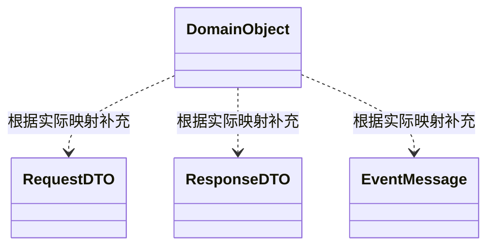
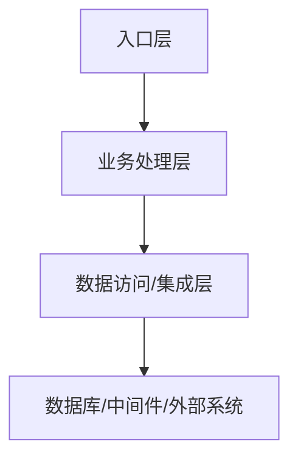
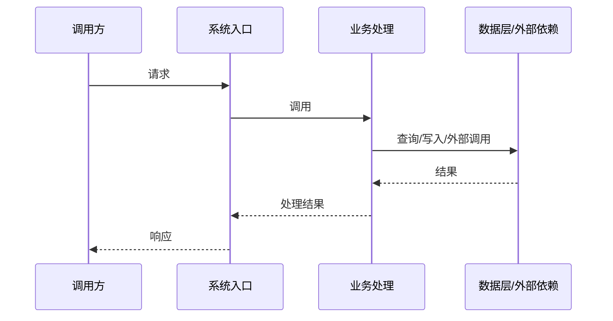
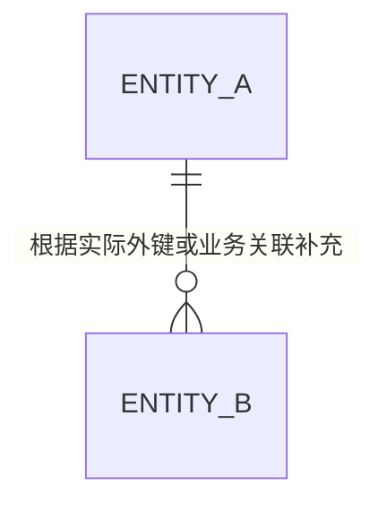

# 01-系统全貌

## 1. 文档说明

### 1.1 分析范围与版本

| 项目 | 内容 |
|---|---|
| 系统/项目名称 | 待分析后填写 |
| 分析模式 | 全量分析 |
| 仓库/项目路径 | 待填写 |
| 代码版本/基线 | 优先记录 Git commit、分支及工作区状态；无 Git 时说明替代依据 |
| 分析范围 | 待填写 |
| 纳入与排除范围 | 待填写 |
| 生成/更新时间 | 待填写 |
| 关联文档 | `02-系统深度分析.md` |
| 验收状态 | 待填写 |

#### 分析范围说明
- 纳入的应用、服务、端、模块和技术资产：
- 排除项及排除原因：
- 扫描、分析与验证边界：

### 1.2 证据等级与可信度说明

| 等级 | 含义 | 使用规则 |
|---|---|---|
| E1 | 源码直接证据 | 可定位到实际代码、SQL、配置或接口定义 |
| E2 | 多源交叉印证 | 多个来源相互支持同一结论 |
| E3 | 工具分析证据 | 由静态分析、代码图谱等工具发现，关键关系应按风险核验 |
| E4 | 上下文推断 | 根据局部实现或上下文推断，不作为确定事实 |
| E5 | 待验证 | 当前证据不足，不能下确定结论 |

证据等级不代表生产运行时确定性。源码中存在某段逻辑，不等于已证明该逻辑在生产环境实际执行。

关键结论应尽可能提供关联对象 ID、文件路径、类/方法/SQL/配置位置、证据等级、适用边界和不确定性。

### 1.3 已知限制与待验证事项

| ID | 限制/待验证事项 | 关联对象 | 影响 | 当前缺失证据 | 验证方法 | 优先级 | 状态 |
|---|---|---|---|---|---|---|---|

说明工具不可用、源码缺失、外部系统不可访问、动态调用难以静态识别、运行环境不可见等限制，以及这些限制对结论的影响。

## 2. 系统构思

### 2.1 系统目标与业务定位

- 系统解决的业务问题：
- 主要用户与使用场景：
- 核心业务能力：
- 系统边界及不负责的范围：
- 相关业务系统及上下游：

### 2.2 总体设计思路

说明从代码和配置中能够确认的总体设计思路，包括应用组织方式、分层方式、核心业务处理路径、数据处理方式、同步/异步机制和系统集成方式。区分源码事实与设计推断。

### 2.3 核心设计约束

| 约束 ID | 约束内容 | 类型（业务/技术/部署/兼容/安全等） | 约束来源 | 影响范围 | 证据等级 |
|---|---|---|---|---|---|

### 2.4 关键设计决策

| 决策 ID | 设计决策 | 可观察到的实现依据 | 可能的选型原因 | 影响与权衡 | 证据等级/待验证项 |
|---|---|---|---|---|---|

只有存在文档、注释、配置或其他证据时，才将选型原因表述为已确认事实；否则明确标记为推断。

### 2.5 已确认事实、推断与未知项

| 类型 | 内容 | 关联对象 ID | 依据/证据 | 后续行动 |
|---|---|---|---|---|
| 已确认事实 | | | | |
| 推断 | | | | |
| 未知/待验证 | | | | |

## 3. 关键技术与算法

### 3.1 技术栈与运行环境

| 类别 | 技术/版本 | 使用位置 | 用途 | 证据来源 | 确认状态 |
|---|---|---|---|---|---|
| 语言 | | | | | |
| 框架 | | | | | |
| 构建工具 | | | | | |
| 运行环境 | | | | | |
| 数据存储 | | | | | |
| 其他 | | | | | |

### 3.2 核心框架与中间件

| 技术/组件 | 版本或配置 | 用途 | 关联模块 | 关键配置/代码位置 | 证据等级 |
|---|---|---|---|---|---|

### 3.3 通信协议与集成技术

覆盖适用的 HTTP/REST、RPC、MQ、WebSocket、设备协议、文件交换、数据库访问及其他集成方式。

| 协议/技术 | 使用场景 | 发起方 | 接收方 | 关键入口/配置 | 异常处理特征 | 证据 |
|---|---|---|---|---|---|---|

### 3.4 关键算法与处理机制

| 算法/机制 | 业务用途 | 输入 | 核心处理逻辑 | 输出/副作用 | 实现位置 | 证据等级 |
|---|---|---|---|---|---|---|

关注实际存在的规则引擎、计算逻辑、去重、聚合、调度、重试、限流、缓存、排序、状态判断等机制；不适用时说明，不要为了填满章节而虚构算法。

### 3.5 技术选型依据及证据

| 技术决策 | 已确认的选型依据 | 推断的考虑因素 | 可验证证据 | 未确认事项 |
|---|---|---|---|---|

## 4. 关键数据结构

### 4.1 核心领域对象

| 对象 ID | 对象/类名称 | 业务含义 | 关键字段 | 创建/维护位置 | 关联功能 | 证据 |
|---|---|---|---|---|---|---|

### 4.2 请求、响应与传输对象

| 对象 ID | DTO/VO/请求/响应名称 | 用途 | 关键字段 | 生产方/消费方 | 关联接口 | 代码位置 |
|---|---|---|---|---|---|---|

### 4.3 消息与事件结构

| 消息 ID | 消息/事件名称 | 关键字段 | 生产方 | 消费方 | 主题/路由 | 代码位置 | 证据 |
|---|---|---|---|---|---|---|---|

### 4.4 缓存及其他关键数据结构

| 对象 ID | 结构类型 | 名称/键规则 | 数据内容 | 生命周期/失效机制 | 读写位置 | 证据 |
|---|---|---|---|---|---|---|

### 4.5 结构间关系

正式输出必须根据源码替换示意实体和关系。表格说明领域对象、DTO、数据库实体、消息体及缓存结构之间的映射、转换和依赖。

## 5. 系统总体结构

### 5.1 系统分层架构图

此图为模板示意。生成正式文档时必须按项目实际架构重绘，不得将示意层次直接当成已确认架构。

### 5.2 模块与子模块清单

| 模块 ID | 模块/子模块 | 所属端/应用 | 主要职责 | 关键入口 | 主要依赖 | 分析状态 |
|---|---|---|---|---|---|---|

组织规则：存在 Web、APP、小程序、大屏等可视化端时，优先按端及业务功能组织；无法识别端结构或项目仅有后端代码时，按微服务、应用、业务模块或技术分层组织，并继续识别具体业务功能。

### 5.3 模块职责及边界

| 模块 ID | 核心职责 | 输入 | 输出 | 不负责的内容/边界 | 共享能力 | 证据 |
|---|---|---|---|---|---|---|

### 5.4 模块依赖关系图

正式图应展示实际模块、依赖方向和必要的关系类型；依赖关系需有代码、配置或接口证据支持。

### 5.5 公共模块与基础设施

| 对象 ID | 公共组件/基础设施 | 职责 | 使用方 | 关键配置/入口 | 影响范围 | 证据 |
|---|---|---|---|---|---|---|

### 5.6 部署单元与运行时组件

| 部署/运行单元 ID | 应用/进程/容器 | 启动方式 | 运行环境 | 端口/服务发现 | 依赖组件 | 配置证据 | 确认状态 |
|---|---|---|---|---|---|---|---|

区分源码中可确认的部署描述与实际生产运行状态；没有部署配置或运行证据时，不得猜测实例数量、资源配置或部署拓扑。

## 6. 基本处理流程

### 6.1 系统启动与初始化流程

说明入口类、启动配置、依赖装配、初始化任务、监听器注册、定时任务启动及启动失败处理。只描述实际识别到的机制。

### 6.2 主要控制流程

说明主要控制入口、请求分发、业务规则判断、权限校验、事务控制及主要分支。

### 6.3 主要请求处理流程

正式输出时按实际代码替换参与者、顺序和交互；若系统不存在统一请求处理流程，应按入口类型分别说明。

### 6.4 异步处理与异常处理流程

覆盖适用的消息消费、事件监听、定时任务、线程池、回调、重试、补偿、异常传播和失败记录。

### 6.5 系统流程图

用一张或多张 Mermaid 图总结主要控制流程。对复杂系统按应用、入口类型或核心链路拆图，并标明图的分析边界及证据状态。

## 7. 数据流程

### 7.1 核心数据及其来源

| 数据对象 ID | 数据名称 | 来源 | 产生入口 | 主要消费者 | 业务用途 | 证据 |
|---|---|---|---|---|---|---|

### 7.2 数据流转图

正式图必须根据实际数据流转关系生成；必要时区分同步调用、异步消息和外部系统边界。

### 7.3 数据转换与处理动作

| 步骤 ID | 输入对象 | 转换/处理动作 | 输出对象 | 执行位置 | 业务规则 | 证据 |
|---|---|---|---|---|---|---|

### 7.4 持久化、缓存与消息流转

| 数据对象/表/消息 ID | 操作类型 | 生产方/写入方 | 消费方/读取方 | 触发条件 | 一致性/失效机制 | 证据 |
|---|---|---|---|---|---|---|

### 7.5 数据流转的验证边界

说明已追踪到的最终存储、消息消费者、外部调用或业务终点，以及因源码、权限、外部系统或运行证据缺失而无法继续验证的边界。

## 8. 功能需求与模块的关系

### 8.1 正式需求编号与来源

| 需求 ID | 需求名称/描述 | 来源文档/系统 | 版本/日期 | 对应功能 ID | 证据/确认状态 |
|---|---|---|---|---|---|

只有在需求文档、工单、需求编号或其他可信来源中实际存在时，才记录为正式需求。若源码只能支持功能识别而无法找到正式需求来源，应标记为“代码识别功能，未找到正式需求编号”，不得编造需求编号。

### 8.2 功能—模块分配矩阵

| 功能 ID/需求 ID | Web | APP | 小程序 | 大屏 | 后端应用/模块 | 数据/接口依赖 | 证据状态 |
|---|---|---|---|---|---|---|---|

按实际项目增删端列。使用明确符号说明主实现、调用、共用或不涉及，并在表下注明符号含义。

### 8.3 尚未映射的功能与模块

| 对象 ID | 功能/模块 | 未映射原因 | 缺少的证据 | 影响 | 验证方法 | 状态 |
|---|---|---|---|---|---|---|

## 9. 接口设计

### 9.1 外部接口总览

| 接口 ID | 接口名称 | 类型 | 提供方 | 调用方 | 协议/地址/主题 | 认证方式 | 关联功能 | 证据 |
|---|---|---|---|---|---|---|---|---|

### 9.2 硬件与设备接口

说明设备接入方式、通信协议、报文/数据模型、设备标识、连接管理、采集/控制流程、超时、重连及异常处理。没有设备接口时说明不适用。

### 9.3 外部系统与第三方接口

| 接口 ID | 外部系统 | 调用方式 | 请求/响应契约 | 超时/重试 | 失败影响 | 代码/配置位置 |
|---|---|---|---|---|---|---|

### 9.4 对外提供的接口服务

| API ID | 方法/协议 | 路径/标识 | 用途 | 请求/响应对象 | 权限 | 实现位置 | 证据 |
|---|---|---|---|---|---|---|---|

### 9.5 内部模块接口

| 接口 ID | 调用方模块 | 被调用方模块 | 方法/契约 | 同步/异步 | 关键约束 | 证据 |
|---|---|---|---|---|---|---|

### 9.6 消息、事件与异步接口

| 消息 ID | 主题/事件 | 生产方 | 消费方 | 消息结构 | 顺序/重试/幂等机制 | 证据 |
|---|---|---|---|---|---|---|

### 9.7 接口异常、认证与权限机制

说明实际识别到的认证、授权、签名、访问控制、参数校验、错误码、超时、重试、限流、幂等和审计机制。将已确认机制与待验证事项分开。

## 10. 数据库设计概要

### 10.1 数据存储技术与实例

| 存储 ID | 技术/实例 | 用途 | 环境/配置来源 | 关联应用 | 证据/确认状态 |
|---|---|---|---|---|---|

不得在没有证据时填写实际生产实例、容量、部署数量或运行状态。

### 10.2 数据访问架构

说明数据访问层、ORM/Mapper、Repository/DAO、SQL 管理方式、事务管理和多数据源机制。

### 10.3 模块与数据库的关系

| 模块 ID | 数据存储 ID | 访问方式 | 涉及表/集合 | 主要读写操作 | 证据 |
|---|---|---|---|---|---|

### 10.4 核心实体及表的关系

| 表 ID | 表/集合名称 | 核心字段 | 业务含义 | 关联表/对象 | 读写方 | 证据 |
|---|---|---|---|---|---|---|

正式输出只绘制有证据支持的关系；若只是业务关联而非数据库外键，应明确标注关系依据。

### 10.5 事务、一致性与缓存机制

说明事务边界、跨表写入、跨服务一致性、乐观/悲观锁、幂等、缓存读写和失效策略、重复消息处理及失败补偿。区分已确认实现与风险推断。

### 10.6 数据库设计说明的交叉引用

| 数据库对象/表 ID | 详细说明文档/章节 | 关联功能 ID | 关联链路 ID | 待验证项 |
|---|---|---|---|---|

若没有独立数据库设计文档，应直接引用本系统分析文档中的相关章节或标明尚未形成独立说明，不得虚构文档。

## 11. 全局索引、覆盖统计与验收

### 11.1 统一对象索引

| 对象 ID | 对象类型 | 名称 | 关联对象 | 证据/分析状态 | 详细分析位置 |
|---|---|---|---|---|---|

### 11.2 覆盖统计

| 指标 | 分子 | 分母 | 结果 | 统计口径与限制 |
|---|---:|---:|---|---|
| 源文件扫描覆盖率 | | | | |
| 方法分析覆盖率 | | | | |
| 入口分析覆盖率 | | | | |
| 功能登记覆盖率 | | | | |
| 关键链路完成率 | | | | |
| 关键关系证据覆盖率 | | | | |

无法可靠确定分母时，标注“无法准确统计”并说明原因。

### 11.3 质量验收结论

- 验收状态：通过 / 有条件通过 / 未通过 / 无法完成验收
- 主要依据：
- 已知缺口：
- 未关闭的待验证事项：
- 后续建议：

### 11.4 与 `02-系统深度分析.md` 的一致性检查

- 模块、功能、入口和链路 ID 是否一致：
- 架构、依赖、接口和数据关系是否一致：
- 统计口径是否一致：
- 需要补充或回写的全局事实：
