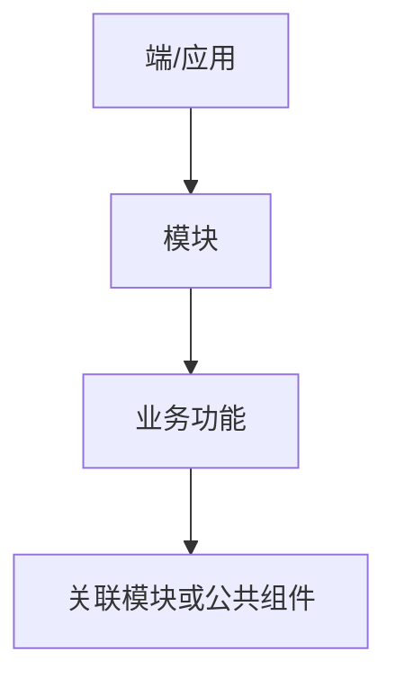
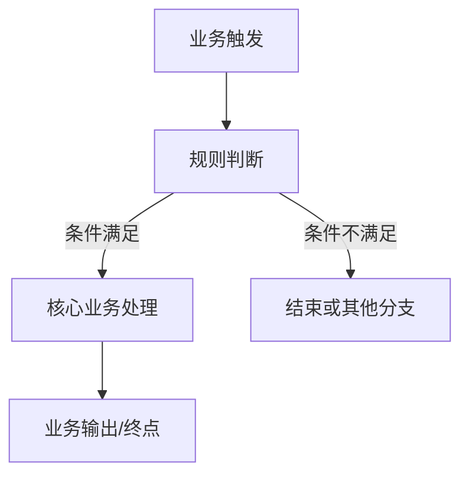
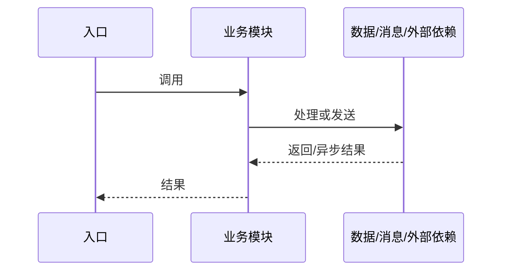
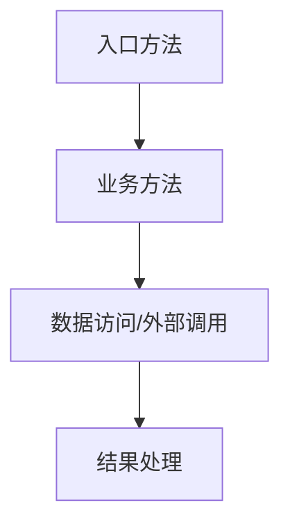
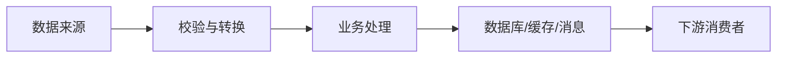
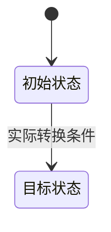

# 02-系统深度分析

> 本文档以功能模块、业务链路、代码实现、数据流转、开发影响五个核心维度为主线，全面梳理系统的业务功能及其实际代码实现，建立从业务需求到代码、数据和修改影响的完整追溯关系。

## 1. 功能模块

梳理系统有哪些功能、各功能负责什么业务，以及功能之间的关系。

- **模块划分：** 优先按照 Web、APP、小程序、大屏等可视化端组织；无法识别端结构时，按照微服务、应用、业务模块或技术分层组织。
- **功能清单：** 列出各模块的具体功能，例如告警查询、告警确认、告警规则配置、告警通知。
- **功能说明：** 说明每个功能的业务目的、输入、处理逻辑、输出、前置条件和边界。
- **入口与触发方式：** 识别页面操作、HTTP 接口、定时任务、MQ 消费、设备上报、回调等入口。
- **模块依赖：** 梳理功能调用了哪些模块，以及哪些功能共享公共组件或数据。
- **功能关系图：** 展示模块层级、功能归属及模块间的依赖关系。

### 1.1 系统与分析基线

| 项目 | 内容 |
|---|---|
| 系统/项目 | |
| 代码基线 | |
| 分析范围 | |
| 生成/更新时间 | |
| 关联全貌文档 | `01-系统全貌.md` |
| 验收状态 | |

### 1.2 模块与功能清单

| 模块 ID | 模块/端 | 功能 ID | 功能名称 | 业务目的 | 输入/输出 | 前置条件与边界 | 分析状态 |
|---|---|---|---|---|---|---|---|

### 1.3 入口与触发方式

| 入口 ID | 类型 | 入口名称/路径 | 关联功能 ID | 调用方/触发方 | 代码位置 | 证据等级 |
|---|---|---|---|---|---|---|

### 1.4 模块与功能关系图

正式输出必须根据实际证据替换示意节点和关系。

### 1.5 模块依赖关系

| 源模块/功能 ID | 关系类型 | 目标模块/功能 ID | 依赖原因 | 证据位置 | 证据等级 |
|---|---|---|---|---|---|

## 2. 业务链路

梳理每项核心业务从触发到完成的完整过程，明确业务步骤、执行条件、分支和终点。

- **端到端链路：** 例如设备上报 → 规则判断 → 告警生成 → 告警持久化 → 消息通知 → 用户确认。
- **链路步骤：** 逐步说明每个环节的触发条件、执行动作、处理结果和下一步。
- **调用关系：** 梳理链路跨越的模块、服务、接口、消息及后台任务。
- **条件分支：** 分析规则命中与未命中、重复告警、权限不足、确认失败等不同路径。
- **异常处理：** 分析超时、失败、重试、补偿、事务回滚和异步处理。
- **业务终点：** 明确链路何时完成；无法继续追踪时，记录边界及待验证事项。
- **流程图与时序图：** 使用 Mermaid 展示业务流程、跨模块调用和异步交互。

### 2.1 核心业务链路清单

| 链路 ID | 链路名称 | 关联功能 ID | 触发入口 | 关键步骤 | 业务终点/验证边界 | 完成状态 |
|---|---|---|---|---|---|---|

### 2.2 链路步骤明细

| 步骤 ID | 顺序 | 触发条件 | 执行动作 | 处理结果 | 下一步/分支 | 关联代码 ID/位置 | 证据 |
|---|---:|---|---|---|---|---|---|

### 2.3 业务流程图

正式输出应使用实际业务步骤、条件和终点替换示意内容。

### 2.4 跨模块调用时序图

### 2.5 分支、异常、异步与终点核验

| 场景 ID | 场景类型 | 条件/触发 | 实际处理 | 重试/补偿/事务 | 终点或缺口 | 证据 |
|---|---|---|---|---|---|---|

## 3. 代码实现

将业务链路落实到实际代码，说明每个业务步骤具体由哪些代码实现。

- **代码入口：** Controller、Service 入口、MQ Listener、定时任务、设备协议处理器、回调等。
- **调用链：** 具体文件路径、类名、方法名、调用顺序、调用方和被调用方。
- **处理逻辑：** 核心算法、业务规则、参数校验、条件判断、循环和分支。
- **输入与输出：** 方法参数、返回值、数据结构及其他副作用。
- **异常与事务：** 异常捕获和传播、事务边界、回滚、重试、幂等及补偿。
- **异步机制：** 线程池、消息队列、事件驱动、定时任务及异步结果处理。
- **代码证据：** 为关键结论提供文件路径、类、方法及相关代码位置。
- **调用关系图：** 展示关键方法的调用顺序、跨模块依赖和异步分支。

### 3.1 入口、类与方法清单

| 对象 ID | 入口/文件路径 | 类名 | 方法名/签名 | 职责 | 调用方 | 被调用方 | 证据等级 |
|---|---|---|---|---|---|---|---|

### 3.2 关键代码调用链

### 3.3 方法级 IPO 分析

| 步骤/方法 ID | Input（参数/上下文） | Process（处理逻辑） | Output（返回/副作用） | 分支/异常 | 代码证据 |
|---|---|---|---|---|---|

### 3.4 关键业务规则与条件分支

逐项说明规则、判断条件、执行位置、满足与不满足时的行为，以及规则证据。

### 3.5 异常、事务与异步机制

| 机制 ID | 类型 | 实现方式 | 触发条件 | 成功/失败行为 | 代码位置 | 证据/待验证 |
|---|---|---|---|---|---|---|

### 3.6 代码关系与证据索引

| 源对象 ID | 关系类型 | 目标对象 ID | 文件/符号位置 | 证据等级 | 核验状态 |
|---|---|---|---|---|---|

## 4. 数据流转与状态流转

梳理业务数据从产生、处理、传递到持久化的全过程，明确数据和业务状态如何变化。

- **数据对象：** 识别相关数据库、表、集合、消息、缓存及关键字段。
- **读写关系：** 明确每张表由哪些代码查询、新增、修改或删除，以及触发条件。
- **字段含义：** 梳理字段类型、业务含义、默认值、校验规则及关联关系。
- **数据流转：** 说明数据从哪里产生，经过哪些处理，最终保存或发送到哪里。
- **状态流转：** 梳理状态初始值、转换条件、执行动作、目标状态和终止状态。
- **关键业务字段：** 例如告警状态、确认人、确认时间、处理结果及通知状态，并追踪实际读写位置。
- **一致性与异常：** 分析事务、并发更新、重复消息、缓存一致性、失败补偿等问题。
- **数据关系图：** 使用 Mermaid 展示数据流转、表关联和状态机。

### 4.1 数据对象与来源

| 数据对象 ID | 对象/表/集合/消息 | 来源 | 关键字段 | 生产代码 | 消费代码 | 证据 |
|---|---|---|---|---|---|---|

### 4.2 表与字段读写清单

| 表 ID | 表名 | 字段/字段 ID | 查询/新增/修改/删除 | 触发条件 | SQL/代码位置 | 业务含义与证据 |
|---|---|---|---|---|---|---|

### 4.3 数据流转图

正式输出应以实际证据为依据，区分同步、异步和外部系统边界。

### 4.4 状态流转清单

| 状态机 ID | 当前状态 | 目标状态 | 转换条件 | 执行动作 | 执行位置 | 持久化位置 | 证据 |
|---|---|---|---|---|---|---|---|

### 4.5 状态图

只有证据支持时才输出实际状态图。没有独立状态机时说明原因；证据不足时标记待验证。

### 4.6 一致性、并发与异常补偿

分析事务边界、并发写入、重复消息、幂等、缓存失效、跨服务一致性和失败补偿。区分已确认的实现与基于风险的推断。

## 5. 开发影响分析

建立系统级影响关系，使 AI 在接到开发需求时，能够从需求定位到修改点，并识别可能受影响的其他功能。

- **需求与功能映射：** 将需求对应到功能模块、业务链路和技术入口。
- **修改点定位：** 找出需要新增、修改或删除的类、方法、接口、配置、表及字段。
- **直接影响：** 识别修改对象直接涉及的功能和调用方。
- **间接影响：** 沿调用关系、共享组件、接口、数据表、状态和消息关系递归追踪下游影响。
- **跨端影响：** 检查 Web、APP、小程序、大屏及后台服务是否存在关联。
- **风险分析：** 评估业务逻辑、数据兼容、状态一致性、并发、性能、权限及外部依赖风险。
- **验证方案：** 明确需要执行的单元测试、集成测试、异常场景测试和回归测试。
- **待验证事项：** 对证据不足的修改影响、隐式依赖和未知行为登记验证方法。

### 5.1 需求—功能—链路—代码映射

| 需求 ID/来源 | 功能 ID | 链路 ID | 入口 ID | 相关代码 ID | 数据/状态对象 | 证据/状态 |
|---|---|---|---|---|---|---|

如果未找到正式需求编号或需求文档，应明确标记“未找到正式需求来源”，不得虚构需求 ID。

### 5.2 修改点候选

| 对象 ID | 对象类型 | 文件/符号/表/接口 | 建议操作（新增/修改/删除/核验） | 修改依据 | 证据等级 |
|---|---|---|---|---|---|

修改点是基于分析得到的候选范围，不代表已执行代码修改。

### 5.3 直接与间接影响范围

| 受影响对象 ID | 对象/功能 | 影响路径 | 直接/间接 | 影响原因 | 风险 | 证据 |
|---|---|---|---|---|---|---|

### 5.4 跨端与契约影响

检查 Web、APP、小程序、大屏、后台任务、外部接口、消息消费者、数据库结构和共享组件是否受影响。

### 5.5 风险评估

| 风险 ID | 风险类型 | 风险描述 | 发生条件 | 影响范围 | 优先级 | 证据/推断 | 缓解或验证方案 |
|---|---|---|---|---|---|---|---|

### 5.6 测试与回归建议

| 测试场景 ID | 测试类型 | 前置条件 | 输入/操作 | 预期结果 | 对应链路/分支 | 是否已有测试 |
|---|---|---|---|---|---|---|

区分已有测试证据与建议新增的测试，不得将未执行的测试描述为已通过。

### 5.7 待验证事项

| ID | 问题/未知影响 | 关联对象 | 业务影响 | 优先级 | 验证方法 | 关闭条件 | 状态 |
|---|---|---|---|---|---|---|---|

## 6. 全局关系索引与证据

### 6.1 统一对象索引

| 对象 ID | 类型 | 名称 | 关联对象 | 详细分析位置 | 状态 |
|---|---|---|---|---|---|

### 6.2 证据索引

| 证据/对象 ID | 支持的结论 | 文件路径 | 类/方法/SQL/配置位置 | 证据等级 | 适用边界 |
|---|---|---|---|---|---|

### 6.3 关系索引

| 源对象 ID | 关系类型 | 目标对象 ID | 证据位置 | 证据等级 | 核验状态 |
|---|---|---|---|---|---|

## 7. 覆盖统计与质量验收

| 指标 | 分子 | 分母 | 结果 | 统计口径与限制 |
|---|---:|---:|---|---|
| 源文件扫描覆盖率 | | | | |
| 方法分析覆盖率 | | | | |
| 入口分析覆盖率 | | | | |
| 功能登记覆盖率 | | | | |
| 关键链路完成率 | | | | |
| 关键关系证据覆盖率 | | | | |

无法可靠确定分母时，应说明原因并标记无法准确统计，不得编造覆盖率。

### 验收结论
- 状态：通过 / 有条件通过 / 未通过 / 无法完成验收
- 验收依据：
- 已完成范围：
- 未完成范围及原因：
- 未关闭的待验证事项：
- 风险与后续建议：

## 8. 全局知识回写记录

| 更新对象 | 新发现的系统级事实/关系/待验证项 | 回写文档 | 状态 |
|---|---|---|---|

若当前没有全局文档，明确说明未执行回写，不得宣称已更新全局基线。
