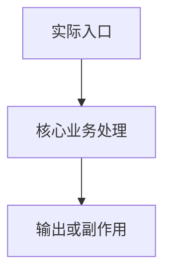
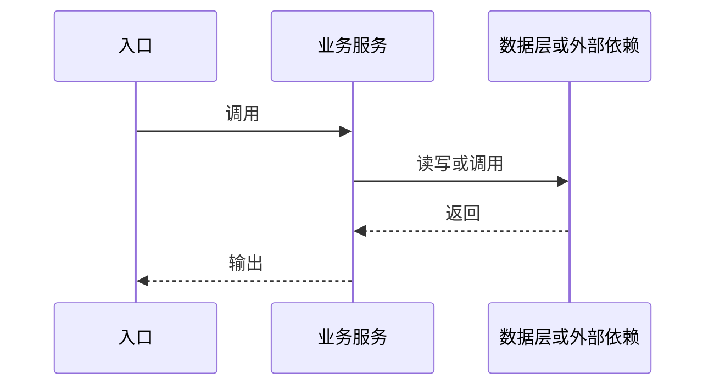
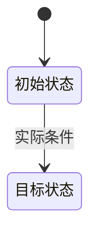

# 功能详细设计：<功能名称>

> 本文档用于对指定功能进行可追溯的代码级分析。按实际证据填写；不适用项说明原因，无法确认项列入待验证清单。

## 1. 基本信息

| 项目 | 内容 |
|---|---|
| 功能名称 | |
| 功能 ID | `FUN-xxx` |
| 所属系统/应用/端 | |
| 所属模块 ID | |
| 代码基线 | |
| 分析范围 | |
| 关联全局文档 | |
| 生成/更新时间 | |
| 验收状态 | |

## 2. 功能概述与边界

### 2.1 业务目标
### 2.2 使用场景
### 2.3 功能边界
### 2.4 前置条件与业务约束
### 2.5 明确不包含的内容

## 3. 功能入口与调用方

| 入口 ID | 入口类型 | 名称/路径 | 调用方 | 代码位置 | 输入 | 证据等级 |
|---|---|---|---|---|---|---|

说明是否存在多个入口，以及不同入口是否共用业务实现。

## 4. 端到端业务链路

### 4.1 链路清单

| 链路 ID | 链路名称 | 触发条件 | 业务终点/验证边界 | 状态 |
|---|---|---|---|---|

### 4.2 主链路流程图

### 4.3 详细步骤

| 步骤 ID | 顺序 | 输入 | 处理规则 | 输出/副作用 | 分支/下一步 | 代码位置 | 证据 |
|---|---:|---|---|---|---|---|---|

### 4.4 关键分支与业务规则
### 4.5 异常路径、重试与补偿
### 4.6 异步链路、消息和回调
### 4.7 业务终点与尚未验证的边界

## 5. 详细代码实现与 IPO

| 对象 ID | 文件路径 | 类/方法/符号 | 职责 | 调用顺序 | 调用方/被调用方 | 证据 |
|---|---|---|---|---|---|---|

### 5.1 关键调用链图

### 5.2 IPO 分析

| 步骤 ID | Input（输入） | Process（处理） | Output（输出及副作用） | 证据位置 |
|---|---|---|---|---|

### 5.3 参数校验、权限与业务规则
### 5.4 关键分支、异常传播与错误处理
### 5.5 事务、并发、异步与幂等

## 6. 数据流转分析

| 数据对象 ID | 来源 | 转换/校验 | 传递方式 | 目标 | 证据 |
|---|---|---|---|---|---|

正式输出时应按实际实现调整。

## 7. 数据表、字段与 SQL

| 表 ID | 表名 | 字段/字段 ID | 操作类型 | 业务含义 | SQL/代码位置 | 事务边界 | 证据等级 |
|---|---|---|---|---|---|---|---|

### 7.1 查询条件与数据范围
### 7.2 新增、更新、删除及批处理
### 7.3 关联表与数据完整性
### 7.4 数据兼容与迁移风险

## 8. 状态流转分析

| 状态机 ID | 当前状态 | 目标状态 | 触发条件 | 执行方法 | 持久化位置 | 并发/幂等约束 | 证据 |
|---|---|---|---|---|---|---|---|

仅在有证据支持时生成具体状态图。若未识别到独立状态机，说明判断依据；若证据不足，明确标记待验证。

## 9. API、消息与外部依赖

### 9.1 API 契约

| API ID | 方法/协议 | 路径/标识 | 请求/响应 | 错误处理 | 兼容性 | 证据 |
|---|---|---|---|---|---|---|

### 9.2 消息与事件

| 消息 ID | 生产方 | 消费方 | 主题/事件 | 触发时机 | 重试/幂等 | 证据 |
|---|---|---|---|---|---|---|

### 9.3 外部依赖

| 外部依赖 ID | 系统/组件 | 调用方式 | 超时/重试 | 失败影响 | 可见证据/限制 |
|---|---|---|---|---|---|

## 10. 模块依赖与开发影响

### 10.1 直接依赖
### 10.2 间接依赖与递归影响
### 10.3 共享组件与跨端影响
### 10.4 修改点候选及其证据

| 对象 ID | 可能修改点 | 修改理由 | 影响范围 | 风险 | 证据/待验证 |
|---|---|---|---|---|---|

### 10.5 回归测试范围

## 11. 异常、风险与非功能特性

| 风险 ID | 风险描述 | 证据 | 影响 | 优先级 | 建议验证/缓解方式 |
|---|---|---|---|---|---|

覆盖适用的权限、事务、并发、幂等、超时、重试、补偿、性能、可观测性、数据一致性及安全问题。

## 12. 验证与测试建议

| 测试 ID/场景 | 前置条件 | 输入/操作 | 预期结果 | 覆盖链路/分支 | 类型 |
|---|---|---|---|---|---|

区分已有测试证据与建议新增的测试，不得声称尚未执行的测试已经通过。

## 13. 证据索引

| 证据 ID/对象 ID | 支持的结论 | 文件路径 | 类/方法/SQL/配置位置 | 证据等级 | 适用边界 |
|---|---|---|---|---|---|

## 14. 待验证项

| ID | 问题 | 关联对象 | 影响 | 优先级 | 验证方法 | 关闭条件 | 状态 |
|---|---|---|---|---|---|---|---|

## 15. 专项结论与全局知识回写

### 15.1 已确认的功能事实
### 15.2 关键链路与数据/状态结论
### 15.3 主要风险和开发影响
### 15.4 分析边界与未解决问题
### 15.5 全局知识回写记录

| 更新对象 | 变更内容 | 回写文档 | 状态 |
|---|---|---|---|

若不存在全局文档，明确标注“未执行全局文档回写：当前无可用全局基线”。
